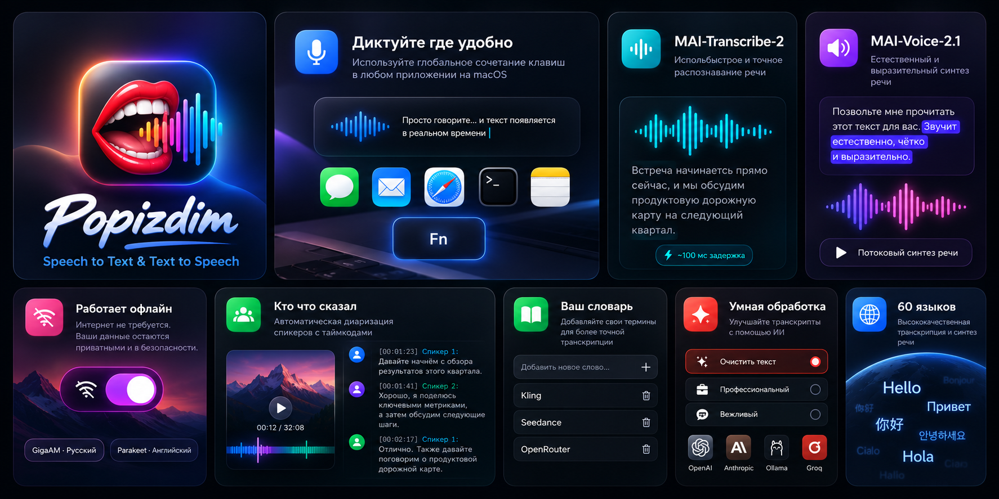

<p align="center">
  
</p>

<h1 align="center">Popizdim — STT & TTS App</h1>

<p align="center">
  Приложение для macOS для диктовки, которое превращает голос в текст и текст в голос.<br>
  Облачные модели <b>Microsoft MAI</b> и открытые локальные модели.
</p>

<p align="center">
  <a href="https://github.com/Asmadey/popizdim-app/releases/latest"><b>Скачать DMG</b></a> ·
  <a href="#установка">Установка</a> ·
  <a href="#настройка">Настройка</a> ·
  <a href="MAI.md">Как это устроено</a> ·
  <a href="#english">English</a>
</p>

---

**Речь в текст (STT / Speech-to-Text) —** зажмите и говорите — текст появится в поле, где стоит курсор. Можно распознавать и готовые записи: любой аудио- или видеофайл, с подписью, кто и когда говорил (диаризация).

**Текст в речь (TTS / Text-to-Speech) —** выделите текст → нажмите кнопку → приложение прочитает RU/EN голосом от <a href="https://ai.azure.com/catalog/models/MAI-Voice-2.1">MAI-Voice-2.1</a>. Длинный текст озвучивается потоком: начало звучит, пока синтезируется продолжение.

## Возможности

- **Диктовка в любое приложение.** 60 языков с автоопределением, в том числе смешанная речь.
- **Облачные модели Microsoft MAI** — распознавание `MAI-Transcribe-2` и озвучка `MAI-Voice-2.1`
- **Открытые локальные модели** для работы без интернета и без отправки звука в облако:
  - **GigaAM** — очень хорошо распознаёт **русский язык**, лучший выбор для русской диктовки;
  - **Parakeet** — отлично распознаёт **английский язык**, если он вам нужен;
  - **Whisper** и другие модели на выбор.
- **Распознавание** Иконка в трее → «Распознать запись…». MP3, M4A, WAV, FLAC, MP4, MOV, MKV и др.
- **Диаризация: кто что говорил** с метками `[00:01:23] Спикер 1: …`. Локально (pyannote community-1 на CoreML)
- **Словарь.** Выделите слово в любом приложении и выберите в меню **«Добавить в словарь»**
- **Чтение вслух.** «Озвучить текст» в меню или по сочетанию клавиш; на вкладке TTS выбираются голос и скорость в MP3.
- **Постобработка.** Текст расшифровки уходит в LLM. Пресеты: «Улучшение» (орфография, знаки препинания, слова-паразиты), «Профессионально», «Вежливо», «ASD-STE100» (упрощённый технический)
- **Провайдеры:** `OpenAI`, `OpenRouter`, `Groq`, `Ollama` и любой совместимый с OpenAI.
- **Чистая расшифровка.** Убирает «э-э», оговорки и запинки + локальный фильтр слов-паразитов
- **Резерв.** Если Azure недоступен, запись распознаётся через OpenRouter.

## Модели Microsoft MAI

### MAI-Transcribe-2 — речь в текст

Модель Microsoft для распознавания речи на 60 языках. Что она даёт на практике:

- **Диктовка вместо набора.** Говорить быстрее, чем печатать: письма, заметки
- **Текст появляется по ходу речи.** `MAI-Transcribe-2-Streaming`черновой текст приходит через 100 мс.
- **Много языков и смешанная речь.** Автоопределение языка, переключение «на English и обратно»
- **Недорого.** Через OpenRouter около $0.1 за час аудио; нужен только один ключ
- **Работает и с записями.** Интервью, созвоны и лекции превращаются в текст с локальной диаризацией

| Провайдер                          | Модель                       | Как работает                                                  |
| ---------------------------------- | ---------------------------- | ------------------------------------------------------------- |
| Azure Foundry (Realtime WebSocket) | `MAI-Transcribe-2-Streaming` | Настоящий стриминг: черновой текст через ~100 мс              |
| OpenRouter                         | `microsoft/mai-transcribe-2` | Каждая фраза распознаётся на паузе, текст появляется по фразам |

### MAI-Voice-2.1 — текст в речь

Модель Microsoft для синтеза речи (`MAI-Voice-2.1` и быстрая `MAI-Voice-2.1-Flash`, через OpenRouter):

- **Читает вслух что угодно.** Выделите текст и нажмите сочетание клавиш.
- **Потоковое воспроизведение.** Звук идёт потоком, не нужно ждать, пока озвучится весь текст.
- **Вычитка на слух.** Услышав собственный текст, проще заметить корявые фразы и ошибки.
- **Глаза отдыхают.** Прослушивание длинных материалов, пока заняты другим делом 
- **Выбор голоса и скорости**, сохранение в MP3. `Flash` быстрее, `MAI-Voice-2.1` качественнее.

## Установка

1. Скачайте `Popizdim_1.0.dmg` со страницы [Releases](https://github.com/Asmadey/popizdim-app/releases/latest). Готовый DMG собран только для Apple Silicon; на Intel сборка из исходников не проверялась.
2. Откройте DMG и перетащите **Popizdim** в «Программы».
3. Приложение подписано без сертификата Apple Developer, поэтому при первом запуске macOS предупредит о неизвестном разработчике. Разрешите запуск в «Системные настройки» → «Конфиденциальность и безопасность» → «Всё равно открыть» или командой:
   ```bash
   xattr -dr com.apple.quarantine "/Applications/Popizdim.app"
   ```
4. Дайте доступ к **микрофону** и **Универсальному доступу**: без второго приложение не сможет вставлять текст
5. Распознавание файлов в форматах, которые не читаются встроенным декодером, использует ffmpeg: `brew install ffmpeg`.

## Настройка

Откройте вкладку **«Облако»**.

### OpenRouter (самый простой вариант)

1. Создайте ключ на [openrouter.ai/settings/keys](https://openrouter.ai/settings/keys). Нужен обычный ключ для инференса
2. Вставьте его в поле «API-ключ» и нажмите «Проверить».
3. Нажмите «Использовать для диктовки».

Распознавание стоит около $0.1 за час аудио. Тот же ключ используется для MAI-Voice.

### Azure Foundry (настоящий стриминг)

1. Создайте ресурс Microsoft Foundry в регионе, где доступна модель: Sweden Central, Central US, South India и др. (см. [документацию](https://learn.microsoft.com/azure/ai-services/speech-service/mai-transcribe-2-streaming-realtime)).
2. Разверните модель: Build → Models → Deploy a base model → `MAI-Transcribe-2-Streaming`.
3. Вставьте в приложение endpoint ресурса (`https://<ресурс>.services.ai.azure.com`, можно со ссылкой на проект), ключ и имя деплоя.
4. «Проверить» отправляет короткую тестовую расшифровку. Если деплоя нет, приложение так и скажет.

### Полезные настройки

- **Стиль расшифровки → «Чисто»**: без «э-э» и оговорок. Хорошо работает вместе со словарём терминов.
- **Словарь**: имена, бренды, термины. Быстрее всего добавлять их из меню иконки: «Добавить в словарь».
- **Постобработка**: включите переключатель вверху, выберите поставщика, модель и запрос. По умолчанию она работает на обычной клавише диктовки; отдельное сочетание включается переключателем ниже.
- **Продвинутые → Подписи говорящих**: включить или выключить диаризацию для файлов.
- **Общие → Горячая клавиша**: `Option+Space`. Удерживайте для записи или нажмите один раз

Ключи хранятся только локально в настройках приложения (`~/Library/Application Support/com.popizdim.desktop/`)

---

## English

**Popizdim** is a macOS app that turns your voice into text and text into speech, using Microsoft's MAI cloud models and open local models.

- **Speech-to-text:** press a shortcut, speak, and the text is typed into whatever app has focus.
  - **MAI-Transcribe-2-Streaming** (Azure Foundry): true streaming over the Realtime WebSocket API, live text while you speak.
  - **MAI-Transcribe-2** (OpenRouter `microsoft/mai-transcribe-2`): phrase-by-phrase transcription at speech pauses. Only an OpenRouter key is needed.
  - **Open local models:** **GigaAM** (excellent for Russian) and **Parakeet** (excellent for English), plus Whisper and others. Fully offline.
- **Text-to-speech:** select text in any app and press a shortcut; **MAI-Voice-2.1 / Flash** reads it aloud with streaming playback (long text is synthesized in chunks while the previous one plays).
- **Transcribe Recording…** in the menu bar icon: any audio or video file, with local **speaker diarization** (pyannote on CoreML) and minute:second timestamps: `[00:01:23] Speaker 1: …`.
- **Dictionary** tab for your own terms, plus **Add to Dictionary** in the menu bar icon: select a word in any app, click it, and it is added.
- **Post-processing** with a master switch (it runs on the regular dictation hotkey; an optional "Separate hotkey" switch gives it its own); providers include OpenAI, OpenRouter, Anthropic, Groq, Cerebras, **Ollama**, AWS Bedrock, Apple Intelligence and any OpenAI-compatible endpoint. Ready-made prompts: cleanup, professional, polite, ASD-STE100.
- 60 languages with auto-detection, a "clean" style that drops fillers, and Azure → OpenRouter fallback.

Download the DMG from [Releases](https://github.com/Asmadey/popizdim-app/releases/latest) (the ready-made DMG is built for Apple Silicon only, building from source on Intel is untested; ad-hoc signed: allow it in _Privacy & Security_ or run `xattr -dr com.apple.quarantine "/Applications/Popizdim.app"`). Configure keys in **Cloud**.

_Unofficial project, not affiliated with or endorsed by Microsoft. MIT licensed._
